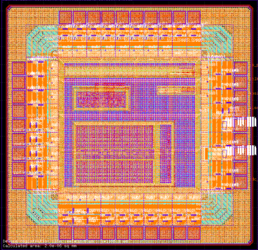
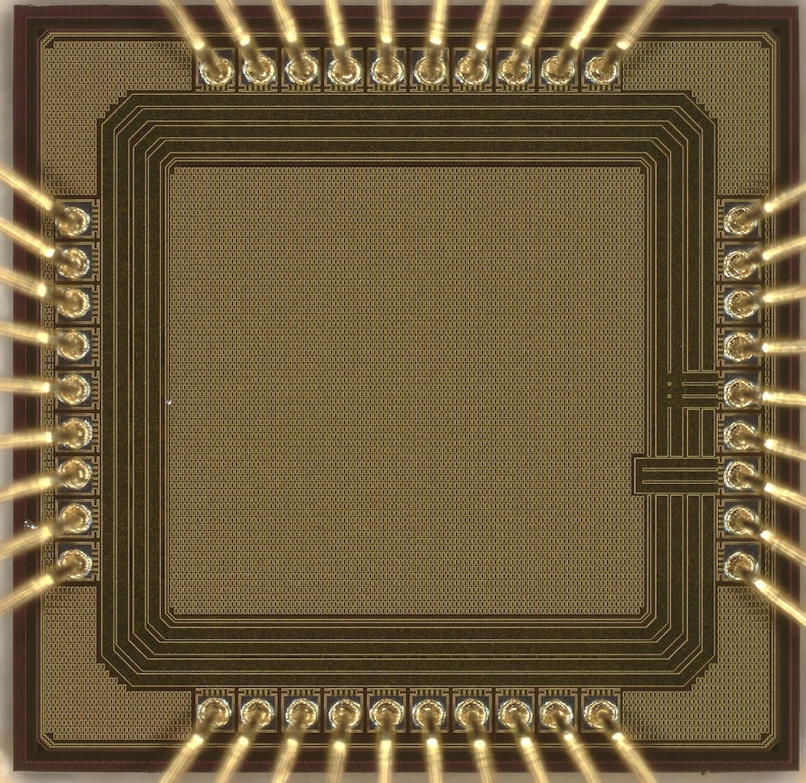
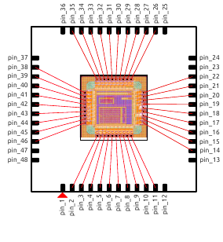

<!-- Generated from report.tex by make_md.py; edit the LaTeX and re-run. -->

[Contents](README.md) · Next: [3 Block design](03-block-design.md)

# 2 The chip

## 2.1 Contents and floorplan

ASICONE was conceived as a vehicle to evaluate the open-source flow and the IHP SG13G2 PDK on real silicon, not as a product. It contains:

- **SARADC**: a 5-bit fully differential charge-redistribution SAR ADC produced by the `saradc_auto` generator [[1]](README.md#references): MOS-gate unit capacitors, a custom switch cell, a dynamic comparator and synthesized SAR logic, all placed and routed by OpenROAD.

- **RO13 and RO101**: two ring oscillators (`ro_reliability`, cells `top_13` and `top_101`) with a device under test (DUT) stage that can be isolated for stress and I–V measurement, each followed by a ÷32 divider and an output pad.

- **SPI**: a configuration slave (8 write registers, 6 read registers of 8 bits) whose registers drive the RO control bits.

| Instance | Cell      |     Origin (μm) |                Size (μm) |
|:---------|:----------|----------------:|-------------------------:|
| `adc`    | `SARADC`  |  (265.0, 220.0) | 566.44 × 361.08 |
| `spi`    | `SPI`     |  (265.0, 643.0) | 311.62 × 128.35 |
| `ro_101` | `top_101` |  (216.0, 838.0) |  727.77 × 48.76 |
| `ro_13`  | `top_13`  | (738.6, 739.54) |  205.17 × 31.81 |

*Table 3: Macros of the top level (coordinates of the 1160 μm × 1122 μm pad-ring area, from `chip/pnr/outputs/asicone_202508.def`). Seven `BUFFD1` and tie cells at the top level build the read-back word of the SPI.*

<figure>
<figure>

<figcaption>Layout (KLayout capture of the submitted GDS).</figcaption>
</figure>
<figure>

<figcaption>Die photograph, bonded in the QFN48 package.</figcaption>
</figure>
<figcaption>Figure 1: ASICONE. In the photograph the metal fill hides the circuits; the 38 bond wires (10 on the top and bottom edges, 9 on the sides) are visible, and so is the seal ring.</figcaption>
</figure>

## 2.2 Pinout

The die is bonded in a QFN48 (0.5 mm pitch); 10 package pins are left open. Table 4 is the pinout as connected on the adapter board (Section [5.2](05-measurement-environment.md#52-adapter-board)).

<figure>

<figcaption>Figure 2: Bonding diagram (<code>QFN48.svg</code>).</figcaption>
</figure>

| Pin | Signal | Pad cell | Board net | Pin | Signal | Pad cell | Board net |
|---:|:---|:---|:---|---:|:---|:---|:---|
| 2 | AVDD | IOPadAnalog | `adc_vdd` (JP5) | 26 | RO_13_Vout | IOPadOut16mA | `ro_13_vout` |
| 3 | adc_rst | IOPadIn | `adc_rst` | 27 | RO_101_Vout | IOPadOut16mA | `ro_101_vout` |
| 4 | adc_clk | IOPadIn | `adc_clk` | 28 | RO2VDD | IOPadAnalog | `ro2_vdd` (JP4) |
| 5–9 | adc_result\[0..4\] | IOPadOut16mA | `adc_result_0..4` | 29 | ROVDD | IOPadAnalog | `ro_vdd` (JP3) |
| 10 | adc_valid | IOPadOut16mA | `adc_valid` | 30 | RO_13_extra_load | IOPadAnalog | `ro_13_ex` |
| 11 | adc_sample | IOPadOut16mA | `adc_sample` | 31 | RO_13_Drain_Sense | IOPadAnalog | `ro_13_ds` |
| 14 | adc_go | IOPadIn | `adc_go` | 32 | RO_13_Drain_Force | IOPadAnalog | `ro_13_df` |
| 15 | VSS | IOPadVssExt | GND | 33 | RO_101_extra_load | IOPadAnalog | `ro_101_ex` |
| 16 | VDD | IOPadVddExt | `vdd1p2` (JP2) | 34 | RO_101_Drain_Sense | IOPadAnalog | `ro_101_ds` |
| 17 | VSSIO | IOPadIOVss | GND | 35 | RO_101_Drain_Force | IOPadAnalog | `ro_101_df` |
| 18 | VDDIO | IOPadIOVdd | `vdd3p3` (JP1) | 38 | RO_13_DUT_gate | IOPadIn | `ro_13_gate` |
| 19 | miso | IOPadOut16mA | `miso` | 39 | RO_101_DUT_gate | IOPadIn | `ro_101_gate` |
| 20 | mosi | IOPadIn | `mosi` | 40 | RO_RST_B | IOPadIn | `ro_rstb` |
| 21 | sclk | IOPadIn | `sclk` | 41 | VSS (RO) | IOPadVssExt | GND |
| 22 | cs | IOPadIn | `cs` | 42 | adc_vip | IOPadAnalog | `adc_vip` (JP9) |
|  |  |  |  | 43 | adc_vin | IOPadAnalog | `adc_vin` (JP10) |
|  |  |  |  | 44 | adc_vrefn | IOPadAnalog | `adc_vrefn` (JP7) |
|  |  |  |  | 45 | adc_vrefp | IOPadAnalog | `adc_vrefp` (JP6) |
|  |  |  |  | 46 | VSS (ADC) | IOPadVssExt | GND |

*Table 4: Pinout. Open package pins: 1, 12, 13, 23, 24, 25, 36, 37, 47, 48. Analog signals connect to the core through the `padres` terminal of `sg13g2_IOPadAnalog` (secondary protection resistor of about 587 Ω and ESD diodes); the ring supplies use the direct `pad` terminal.*

---

[Contents](README.md) · Next: [3 Block design](03-block-design.md)
