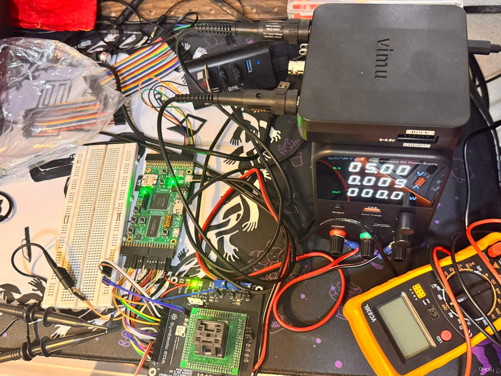
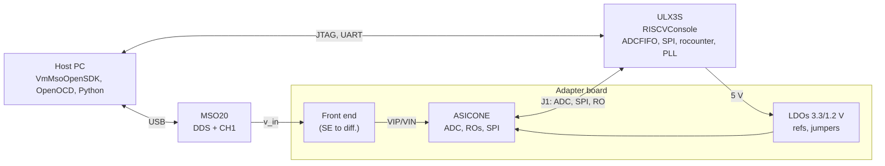

<!-- Generated from report.tex by make_md.py; edit the LaTeX and re-run. -->

[Contents](README.md) · Previous: [4 Design flow and tapeout sequence](04-design-flow-and-tapeout-sequence.md) · Next: [6 SAR ADC measurement](06-sar-adc-measurement.md)

# 5 Measurement environment

<figure>

<figcaption>Figure 3: The bench. Bottom centre: the adapter board with the chip in a QFN48 clamshell socket; left of it the ULX3S FPGA board (Lattice ECP5) wired to the adapter header J1 with jumper wires and a breadboard; top right: the Vimu MSO20 oscilloscope/DDS with its probes; right: a Wanptek programmable DC supply and a VC830L multimeter (used for the reference and supply voltages); a powered USB hub connects the instruments, the JTAG adapter and the FPGA to the host PC.</figcaption>
</figure>

## 5.1 Equipment and signal chain

|  |  |
|:---|:---|
| Device under test | ASICONE in a QFN48 clamshell socket on the adapter board |
| Adapter board | `IHP130_ASICONE_ADP_QFN48_0p5Q_Adapter` (Section [5.2](#52-adapter-board)) |
| Digital host | ULX3S, Lattice ECP5-85F, RISCVConsole SoC: RV64IMAC Rocket core, buses at 50 MHz; ADCFIFO (`0x64003000`), SiFive SPI (`0x64002000`), `rocounter` (`0x64005000`) |
| Firmware | RISCVConsoleCode, branch `ihp` (`src/adc.c`, `src/ro.c`) |
| Signal source | Vimu MSO20BL, DDS channel 1, driven by VmMsoOpenSDK (`software/mso/mso_dds`) |
| Voltage reference | MSO20 channel 1 on the DDS output, DC,  ± 1 V range, 8192 samples per capture |
| ADC clock | 10 MHz from the FPGA PLL; 7 clocks per conversion, $`f_s = 1.4286\,\mathrm{MS/s}`$ |
| Frequency counting | `rocounter`: 3-flop synchronizer and edge counter, gate of 50000000 bus cycles (1 s, 1 Hz resolution at the pad, 32 Hz at the ring) or 100 ms |
| Debug and data | FT232H JTAG (OpenOCD) for boot and buffer dump; ULX3S USB UART at 115200 baud |
| DC | Multimeter VC830L; bench supply (Wanptek) available for supply sweeps through JP3/JP4 |

*Table 5: Equipment.*

*Figure 4: Signal chain of the bench.*

## 5.2 Adapter board

A two-layer 85.5 mm × 85.5 mm board (KiCad, `pcbs/IHP130_ASICONE_ADP_QFN48_0p5Q_Adapter`, assembled from the JLCPCB BOM/CPL files) that plugs into the ULX3S 2×<!-- -->20 header and carries everything the chip needs. All passives are 1206.

| Ref. | Part | Function |
|:---|:---|:---|
| U1 | QFN48 socket | ASICONE |
| U2 | TLV75533PDBV | 3.3 V LDO from the 5 V of J1: op-amps and chip I/O (VDDIO via JP1) |
| U3 | TLV75512PDBV | 1.2 V LDO: core (JP2), ADC (JP5), ROVDD (JP3), RO2VDD (JP4), references, front-end divider |
| U4 | LMV358 | Buffers of VREFP (U4A, JP6) and VREFN (U4B, JP7), set by RV1/RV2 |
| U5 | LMV358 | Single-ended to differential front end (SBOA216 [[5]](README.md#references)) |
| RV1–RV3 | 10 k Ω Bourns 3296W | VREFP, VREFN, and a DC input (RV3, through JP8) |
| R1, R2 | 10 k Ω | 0.6 V common-mode divider |
| R3, R4 | 1 k Ω | Gain resistors of the inverting leg (U5B) |
| R5, R6 | 47.5 Ω | Isolation resistors to the ADC inputs |
| C19 / C20, C21 | 1.2 nF / 120 pF | Differential / common-mode charge reservoir at VIP/VIN |
| C1–C18 | 10 μF + 100 nF | Decoupling of every supply pin |
| Q1, Q2, D1, D2, R7, R8 | 2N7002, LED, 220 Ω | “1.2 V” and “3.3 V” power indicators (MOSFET gate on the LDO output) |
| JP1–JP10 | 2-pin jumpers | Supply, reference and input selection; current measurement points |
| J1 | 2×<!-- -->20 header | ULX3S connection |

*Table 6: Adapter board components.*

#### Front end.

U5A buffers the input ($`v_p = v_{in}`$); U5B is a difference amplifier with R3/R4 referenced to the 0.6 V of R1/R2 ($`v_n = 1.2\,\mathrm{V} - v_{in}`$), so the ADC sees $`v_d = 2(v_{in} - 0.6\,\mathrm{V})`$ at a 0.6 V common mode. R5/R6 with C19–C21 form a differential pole at 1.33 MHz and a common-mode pole at 28 MHz. With VREFP/VREFN = 0.8 V/0.4 V the ideal LSB is 25 mV differential, 12.5 mV at the board input.

#### Header J1.

Pins 1–17: `adc_go` (1), `miso` (2), `adc_sample` (3), `mosi` (4), `adc_valid` (5), `sclk` (6), `adc_result_4..0` (7, 9, 13, 14, 15), `cs` (8), 5 V (11), GND (12, 30), `adc_clk` (16), `adc_rst` (17). RO signals: `ro_rstb` (23), `ro_101_gate` (24), `ro_13_gate` (25), `ro_101_df/ds/ex` (26/27/28), `ro_13_df/ds/ex` (31/32/33), `ro_101_vout` (35), `ro_13_vout` (36).

#### Known limitations of the board.

\(1\) The LMV358 (GBW about 1.4 MHz fitted, slew rate about 1 V/μs) limits the front end above 100 kHz, and its two legs have different bandwidths (unity gain vs. noise gain 2), which turns signal into common mode. (2) The references have no decoupling capacitor at the chip pins. (3) The analog RO pins (`df`, `ds`, `ex`) go to J1 directly and must never see the 3.3 V of the FPGA. A revised front end (fully differential amplifier, decoupled references) is proposed in `RISCVConsole/software/mso/pcbfix`.

---

[Contents](README.md) · Previous: [4 Design flow and tapeout sequence](04-design-flow-and-tapeout-sequence.md) · Next: [6 SAR ADC measurement](06-sar-adc-measurement.md)
