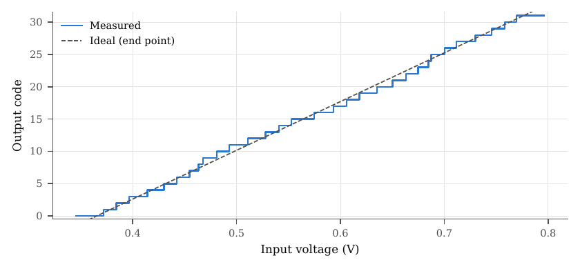
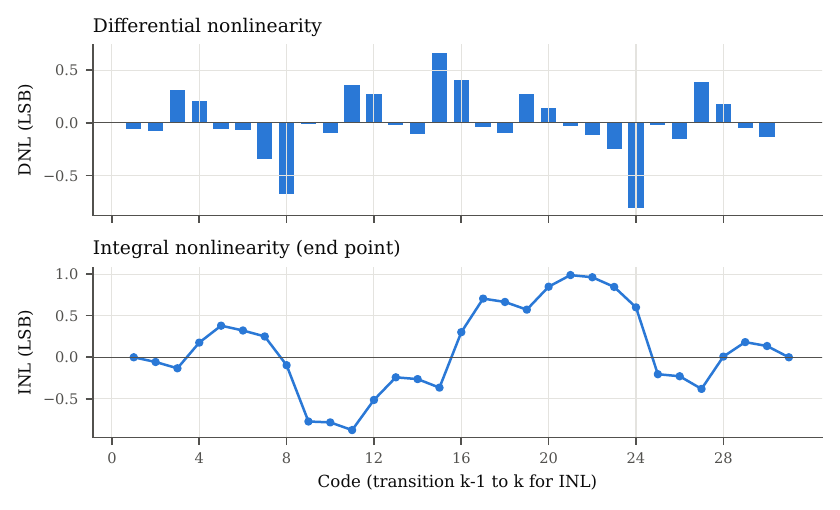
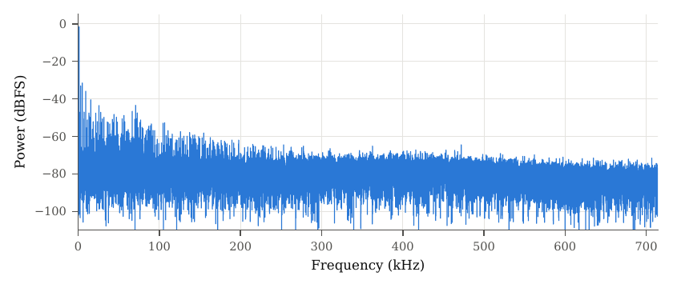
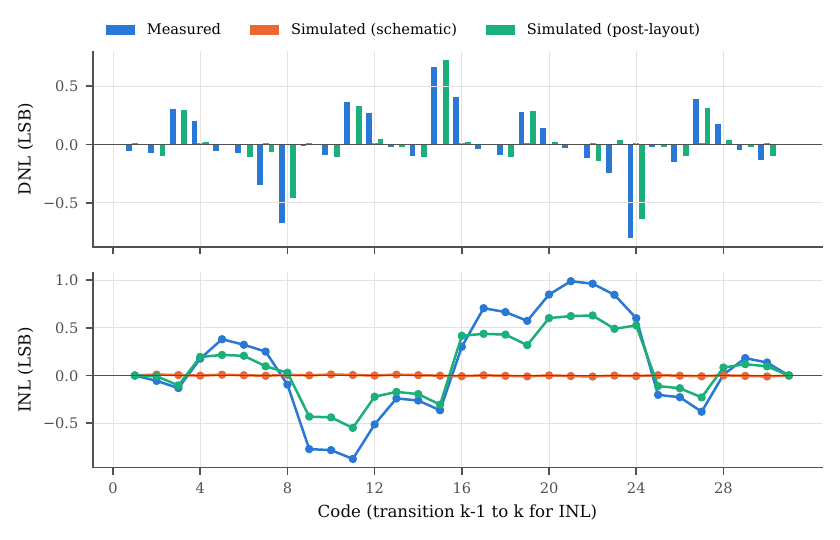
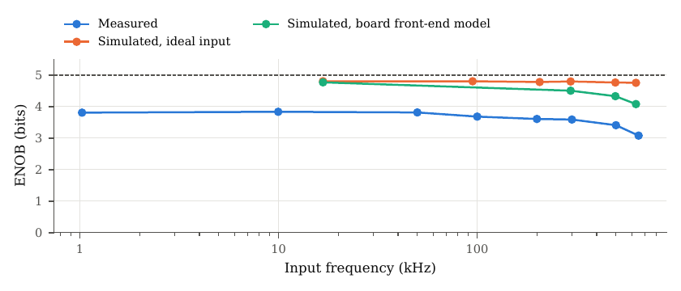

<!-- Generated from report.tex by make_md.py; edit the LaTeX and re-run. -->

[Contents](README.md) · Previous: [5 Measurement environment](05-measurement-environment.md) · Next: [7 Ring oscillator measurement](07-ring-oscillator-measurement.md)

# 6 SAR ADC measurement

Conditions: VDD = AVDD = 1.2 V, VREFP/VREFN = 0.8 V/0.4 V (multimeter), input common mode 0.6 V, 10 MHz clock, $`f_s = 1.4286\,\mathrm{MS/s}`$, 65 536 samples per record, room temperature. Static linearity by the code-density test of IEEE 1241 [[3]](README.md#references) with a 218 Hz triangle overdriving both ends; dynamic performance with coherent sines (odd prime number of periods) and the four-parameter fit of IEEE 1057 [[4]](README.md#references). All voltages are single-ended at the board input. The full analysis is in `RISCVConsole/software/mso/results/sweep_20261022/report/report.pdf`.

## 6.1 Static linearity

|  |  |
|:---|:---|
| Input range (first to last transition) | 0.3719 V to 0.7696 V (ideal 0.4125 V to 0.7875 V) |
| LSB | 13.26 mV (ideal 12.50 mV; gain error 6.1 %) |
| Offset | −29 mV (−2.2 LSB), board and comparator |
| DNL | −0.80 to 0.67 LSB |
| INL (end point) | −0.87 to 0.99 LSB, 0.51 LSB rms |
| Missing codes | none; monotonic |

<figure>

 

<figcaption>Figure 5: Transfer characteristic and DNL/INL from the histogram test.</figcaption>
</figure>

The DNL repeats every 8 codes and the INL jumps at codes 8, 16 and 24: the signature of wrong binary weights in the DAC. A least-squares fit of the transition levels to the bits gives:

| Bit                            |     0     |    1     |    2     |    3     |    4     |
|:-------------------------------|:---------:|:--------:|:--------:|:--------:|:--------:|
| Ideal weight (LSB)             |     1     |    2     |    4     |    8     |    16    |
| Measured weight                |   0.92    |   1.89   |   4.27   |   7.33   |  16.55   |
| Measured error (%)             | −7.8  | −5.7 | +6.7 | −8.4 | +3.5 |
| Schematic simulation (%)       | +0.0  | −0.1 | +0.0 | +0.0 | +0.0 |
| Post-layout, taped-out GDS (%) | −12.5 | −6.8 | +3.3 | −5.2 | +2.3 |

*Table 7: Binary weights of the DAC. After removing them, 0.19 LSB rms of INL remain.*

## 6.2 Dynamic performance

| $`f_{in}`$ (kHz) | $`A`$ (LSB) | SINAD (dB) | ENOB | THD (dB) | SFDR (dB) | H2 (dBc) | H3 (dBc) |
|---:|---:|---:|---:|---:|---:|---:|---:|
| 1.0 | 13.29 | 24.69 | 3.81 | −27.5 | 32.9 | −45.4 | −31.5 |
| 10.0 | 13.29 | 24.85 | 3.84 | −27.4 | 33.0 | −45.1 | −31.4 |
| 50.0 | 13.27 | 24.73 | 3.82 | −27.4 | 32.4 | −46.2 | −32.5 |
| 100.1 | 13.09 | 23.93 | 3.68 | −26.0 | 29.9 | −43.9 | −34.6 |
| 200.0 | 12.80 | 23.48 | 3.61 | −25.2 | 29.8 | −43.9 | −31.1 |
| 300.0 | 12.16 | 23.37 | 3.59 | −25.3 | 29.9 | −39.0 | −33.2 |
| 500.0 | 9.89 | 22.29 | 3.41 | −24.3 | 30.7 | −27.5 | −32.2 |
| 650.0 | 6.66 | 20.30 | 3.08 | −22.9 | 27.6 | −24.3 | −29.9 |

*Table 8: Sine sweep (input 360 mV peak-to-peak DDS setting, 565 mV bias). An ideal 5-bit quantizer at the low-frequency amplitude gives 30.2 dB (4.72 bits).*

<figure>

<figcaption>Figure 6: Spectrum at 1 kHz.</figcaption>
</figure>

Below 50 kHz the measured SINAD equals, within 0.3 dB, the SINAD predicted from the ramp transfer alone: the ENOB of 3.81 bits is entirely the static nonlinearity, i.e. the DAC weights. Above 100 kHz the board front end takes over: the amplitude falls to half at 650 kHz, the common-mode ripple reaches 47 % of the signal and the op-amps approach their slew limit, which produces the rising H2.

## 6.3 Comparison with simulation

<figure>

<figcaption>Figure 7: DNL/INL: chip, schematic and post-layout simulation of the taped-out layout.</figcaption>
</figure>

<figure>

<figcaption>Figure 8: ENOB: chip, transient simulation with ideal input, and with the front-end model of the board.</figcaption>
</figure>

- **Schematic** (ngspice-47, PSP103, TT, 25 °C, board conditions): ideal — weights within 0.1 %, INL 0.006 LSB rms, ENOB 4.80 at low frequency and 4.76 at 631 kHz. The converter core has no dynamic loss up to Nyquist.

- **Post-layout** (split extraction of the taped-out GDS): weight errors with the sign of the measurement on all five bits, INL 0.33 LSB rms, INL correlation 0.98 and DNL correlation 0.90 with the chip, gain error 7.1 % (measured 6.1 %). Quantizing the measured input with the post-layout transitions gives 4.19 bits: the layout accounts for about half of the lost bit, and for the whole error *pattern*.

- **With the board model**, the simulated ENOB falls by about 0.7 bits up to 631 kHz, the same loss as measured (3.81 → 3.08); the measured curve is about one bit below the simulated one at every frequency — the static weights again.

## 6.4 Why the ADC performance is poor

The “efficiency” of the ADC — how much of its 5 bits it delivers — is low: 3.8 of the 4.7 bits an ideal quantizer would give at the same amplitude, and less at high frequency. The causes, in order of weight:

1.  **DAC plate wiring capacitance (layout).** The plates of each bit have wiring capacitance of the order of the unit capacitor itself (about 100 fF per unit on VSH, 65–75 fF on FL), and part of it couples directly to the comparator inputs, differently for every bit: the bit 1/3 bridges add about 10 % of wiring capacitance; the MSB switched plate couples 11.3 fF per unit to its own comparator input, the others about 5 fF; the floating plates of bits 0–3 couple 7–10 fF per unit to the opposite input; and the two halves of the flat layout are not mirror images. This is fully determined by the generator’s routing, not by the process.

2.  **No extraction at tapeout and no time to iterate.** Without extraction rules for SG13G2 the layout could only be verified for DRC and LVS. The ADC reached LVS clean 17 days before the deadline, and the rest of that time went into full-chip closure. The effect was invisible until the split extraction of October 2026.

3.  **Remaining, unexplained part** (0.20 LSB rms of INL; bit 0 less reduced, bit 2 larger, bit 3 smaller than post-layout): of the size that random unit-capacitor mismatch, the wiring resistance (not extracted) or the undecoupled board references can produce. A ramp with 100 nF + 1 μF at pins 44/45 would separate board from chip.

4.  **The board** above 100 kHz (LMV358 front end), which is not the ADC.

The generator has since been corrected (branch `dac-routing-fix`, `docs/dac_wiring.md`): a bridge-less nested capacitor pattern and re-assigned switch-row rails bring the per-unit plate capacitance of all bits within a few percent and the plate-to-comparator coupling below 0.5 fF; a hierarchical layout with one half mirrored halves the post-layout INL (0.17 LSB rms, 4.52 bits). The power of the ADC was not measured, so no figure of merit is given; the current through JP5 is the next measurement.

---

[Contents](README.md) · Previous: [5 Measurement environment](05-measurement-environment.md) · Next: [7 Ring oscillator measurement](07-ring-oscillator-measurement.md)
