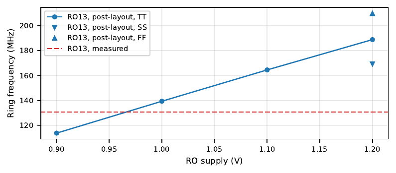

<!-- Generated from report.tex by make_md.py; edit the LaTeX and re-run. -->

[Contents](README.md) · Previous: [6 SAR ADC measurement](06-sar-adc-measurement.md) · Next: [8 SPI: the read-back failure](08-spi-the-read-back-failure.md)

# 7 Ring oscillator measurement

Conditions: ROVDD and RO2VDD from the on-board 1.2 V LDO through JP3/JP4, room temperature, `df`/`ds` tied to 1.2 V, `ex` open, `adc_rst` held high (it is the SPI reset). Firmware `ro_test`, `ro_diag`, `ro_scan`; five runs, 132 restarts per ring in six different ways. Full report: `RISCVConsole/software/ro/results/ro_20261029/report/report.pdf`.

## 7.1 Results

<table>
<caption>Table 9: Ring oscillators: bench against simulation.</caption>
<thead>
<tr>
<th style="text-align: left;"></th>
<th style="text-align: right;">RO13</th>
<th style="text-align: right;">RO101</th>
</tr>
</thead>
<tbody>
<tr>
<td style="text-align: left;">Pad, ring alone (1 s gate)</td>
<td style="text-align: right;">4.088 MHz</td>
<td style="text-align: right;">4.231 MHz</td>
</tr>
<tr>
<td style="text-align: left;">Ring frequency (pad × 32), alone</td>
<td style="text-align: right;">130.8 MHz</td>
<td style="text-align: right;">135.4 MHz</td>
</tr>
<tr>
<td style="text-align: left;">Change when the other ring runs</td>
<td style="text-align: right;">−4.0 %</td>
<td style="text-align: right;">0.2 %</td>
</tr>
<tr>
<td style="text-align: left;">Repeatability (std. dev.)</td>
<td style="text-align: right;">0.10 %</td>
<td style="text-align: right;">0.11 %</td>
</tr>
<tr>
<td style="text-align: left;">Spread over 132 restarts</td>
<td style="text-align: right;">1.24 %</td>
<td style="text-align: right;">0.24 %</td>
</tr>
<tr>
<td style="text-align: left;">Duty cycle at the pad</td>
<td style="text-align: right;">49.6 %</td>
<td style="text-align: right;">49.7 %</td>
</tr>
<tr>
<td style="text-align: left;">Schematic + pad, TT</td>
<td style="text-align: right;">223.9 MHz</td>
<td style="text-align: right;">32.3 MHz</td>
</tr>
<tr>
<td style="text-align: left;">Post-layout (wiring C), TT / SS / FF</td>
<td style="text-align: right;">188.8 / 169.3 / 209.8 MHz</td>
<td style="text-align: right;">27.7 / 25.0 / 30.6 MHz</td>
</tr>
<tr>
<td style="text-align: left;">Post-layout, TT, 1.0 V</td>
<td style="text-align: right;">139.5 MHz</td>
<td style="text-align: right;">20.7 MHz</td>
</tr>
<tr>
<td style="text-align: left;">Measured / post-layout TT</td>
<td style="text-align: right;">0.69</td>
<td style="text-align: right;">4.88</td>
</tr>
<tr>
<td style="text-align: left;"><em>f</em>13/<em>f</em>101</td>
<td colspan="2" style="text-align: center;">measured 0.97, predicted 6.93 (6.86–6.99 over corners)</td>
</tr>
</tbody>
</table>

#### Function.

The SPI writes arrive: in the 16-value scan the rings oscillate only for `0x06`/`0x0e` (`RO_control`=1, `n_RO_control`=0, `DUT_Footer`=1), `RO_RST_B` low stops both outputs and the 50 % duty cycle confirms the dividers. Two observations do not match the design: `DUT_Header` (bit 3) has no visible effect — with the header off the rings keep running (RO13 4.5 %, RO101 −0.2 %) where the DUT can only pull down and the ring should stop — and with the ring open and `DUT_gate`=1 (`0x04`, `0x0c`) RO13 shows a slow 12 kHz oscillation at the pad.

<figure>

<figcaption>Figure 9: Post-layout RO13 against its supply, and the measured frequency.</figcaption>
</figure>

## 7.2 Is the mismatch justified?

The ADC story — missing extraction and no time to iterate — explains a *slower* circuit, because wiring capacitance and resistance can only lower the frequency. It explains part of RO13 and nothing of RO101.

#### RO13: partly justified, not fully.

The extraction lowers RO13 by 16 %, but the chip is a further 31 % below the post-layout TT and below the SS corner; the post-layout ring would need about 0.97 V to match. Candidates: (a) wiring *resistance*, not extracted (the extraction is capacitance only); in a ring of `lv` inverters with 4× fingers this is usually a few percent, not tens; (b) supply and ground drop: RO13 slows 4 % when RO101 runs, which at 12 % per 100 mV means about 40 mV lost for the 0.5 mA of the other ring — some 80 Ω of shared impedance, large for a board, and suggesting a shared on-chip path (both rings return through the core VSS); a 230 mV drop for RO13’s own current would need several hundred ohms, so the supply alone does not close the gap either; (c) the model corner, with the SS corner already 10 % faster than the chip. Each is plausible, none is measured, and together they are at the limit of what they can explain. RO13 is therefore *not yet justified*: ROVDD/RO2VDD must be measured at the jumpers with each ring off, alone and both on, and the ring swept from a bench supply.

#### RO101: not justified by any parasitic.

RO101 runs 4.9× faster than its post-layout fundamental, 37 ps per stage for one edge in 101 stages, which this process cannot do (RO13 shows about 290 ps per stage on the same chip). The measured value matches instead a ring with about seven circulating edges: scaled by RO13’s factor (0.69) the fundamental would be 19.2 MHz and the measurement is 7.05× that — or, equivalently, a single edge in a loop of about 14 stages, almost RO13’s 13. The numbers on the bench support “something short” more than “something slow”: $`f_{13}/f_{101} = 0.97`$ instead of 6.93, a duty cycle of exactly 50 %, and the same frequency after every restart, including the footer-off restart that launches a single edge. In simulation the extracted 101-stage ring does not keep a harmonic mode: an all-zero start begins with 3 edges (4 without wiring capacitance) that merge within 0.75 μs, ending at the fundamental. The extracted cell also has a single 101-stage loop. So either:

- the chip keeps re-creating edges until about seven circulate — the `extra_load` node, slowed by its pad (587 Ω and ESD capacitance), is the first suspect: a slow edge with noise can switch the next stage twice; or

- a short loop exists on silicon that is not in the extracted cell (a defect, or a path outside the cell); or

- the DUT stage is not behaving as designed, which the dead `DUT_Header` control also suggests. One mechanism worth testing: the `Drain_Force`/`Drain_Sense` transmission gates are tied to 1.2 V on the bench; any conduction through them in oscillation mode pulls the DUT output up independently of its header, which would explain why the header has no effect and would distort the DUT edge.

Note that the full-chip LVS matched with the RO netlist flattened, so a wrong chip-level connection of `R[3]`/`R[11]` to `DUT_Header` is unlikely unless it hides in the parts the custom deck ignores. In short, **the RO101 discrepancy is a functional anomaly, not a modelling error**, and it cannot be blamed on the missing extraction.

#### Next measurements.

\(1\) Multimeter on ROVDD/RO2VDD (JP3, JP4) in every state. (2) Sweep ROVDD from the bench supply: in a harmonic mode RO101 jumps by discrete ratios (7, 5, 3, 1 edges), a short loop follows RO13 smoothly. (3) Scope on `ro_101_ex` (J1 pin 28) with a short ground: several pulses per period would confirm extra edges. (4) Leave `df`/`ds` floating or tie them to ground and repeat the header-off test. (5) Extract the chip around the RO macros (top-level routing of the control bits and of VSS).

---

[Contents](README.md) · Previous: [6 SAR ADC measurement](06-sar-adc-measurement.md) · Next: [8 SPI: the read-back failure](08-spi-the-read-back-failure.md)
